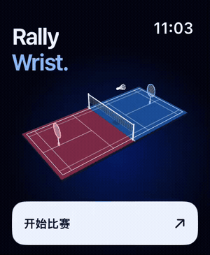
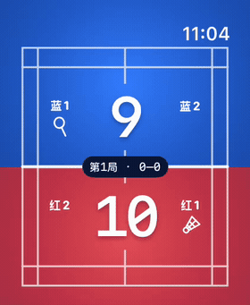
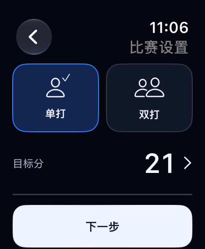
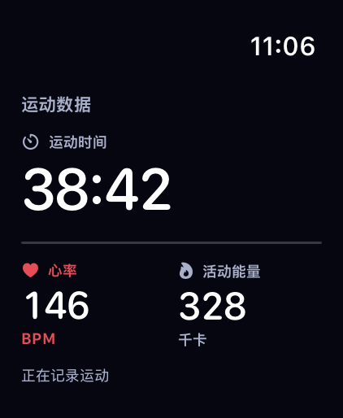
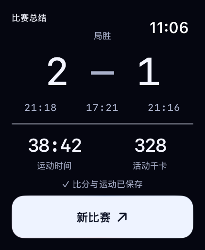

<h1 align="center">RallyWrist</h1>

<strong>每一分，都在腕上。</strong>

Apple Watch 羽毛球计分 · 双打轮转 · 运动记录

<a href="https://evan1u.github.io/RallyWrist-Public/">查看动态介绍 →</a>

## 一划，记下一分。

上划加分，下划减分。双打模式自动更新站位、发球与接发球标记。

## 从开赛，到赛后。

| 准备开赛 | 记录运动 | 赛后回顾 |
| :---: | :---: | :---: |
|  |  |  |
| 选好模式，设定目标。 | 时间、心率、活动能量。 | 比分与运动，一起保存。 |

[打开完整介绍页](https://evan1u.github.io/RallyWrist-Public/) · [备用访问](https://rallywrist-intro.pluckyfield13.chatgpt.site)
